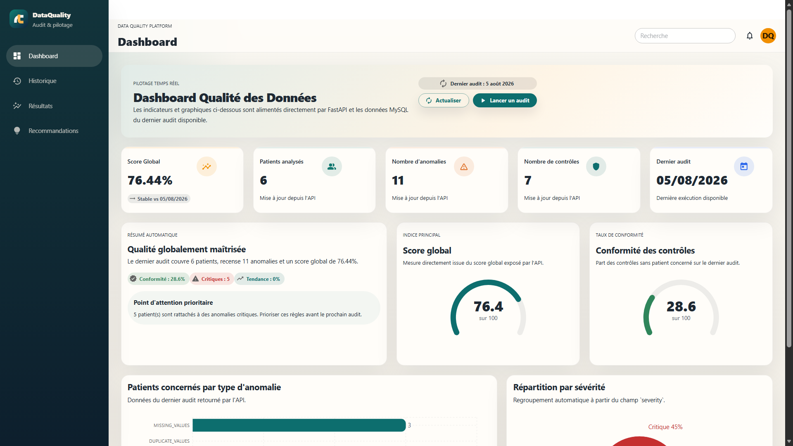
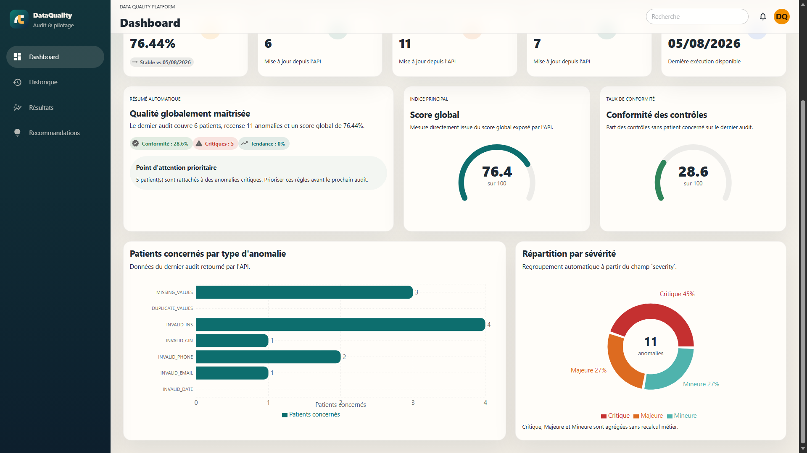
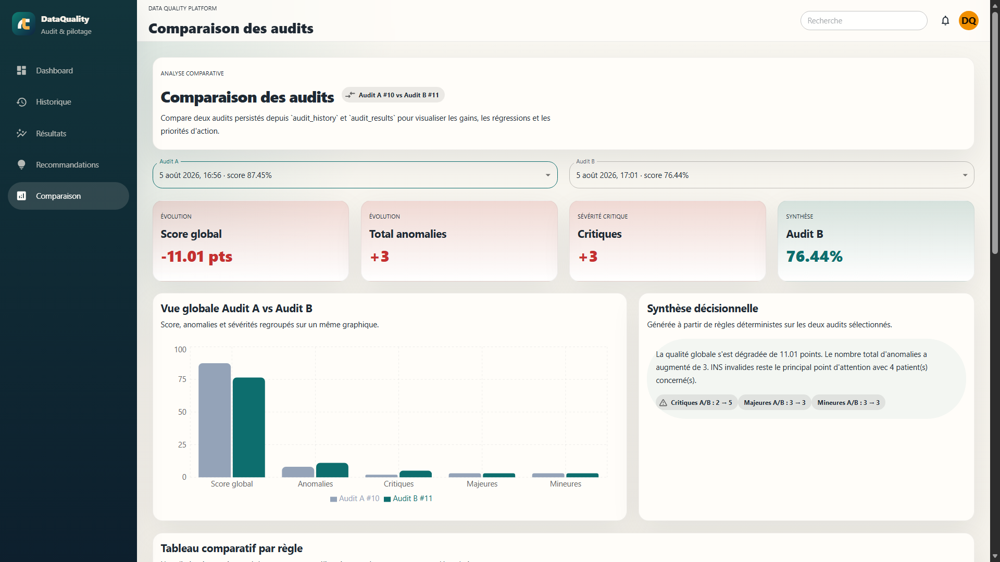

# 🏥 DataQualityPlatform

> **Patient Data Quality Auditing and Decision Support Platform**

A web application designed to assess, measure, track, and visualize patient data quality through a Python auditing engine, a FastAPI API, and a modern React interface.


---

## 🖥️ Application Preview

### 📊 Dashboard



*Overview of patient data quality, key performance indicators, and audit statistics.*

### 📈 Dashboard — Detailed View



*Detailed visualization of data quality metrics and audit results.*

### 📉 Audit Comparison



*Comparison of audit results to evaluate data quality improvements and identify remaining issues.*

---

## 📑 Table of Contents

- [Objectives](#-objectives)
- [Architecture](#-architecture)
- [Technologies](#-technologies)
- [Features](#-features)
- [Python Backend](#-python-backend)
- [FastAPI](#-fastapi)
- [React Frontend](#-react-frontend)
- [Audit Comparison](#-audit-comparison)
- [Data Scenarios](#-data-scenarios)
- [Installation](#-installation)
- [Configuration](#-configuration)
- [Current Status](#-current-status)
- [Architecture Principles](#-architecture-principles)

---

## 🎯 Objectives

The platform enables users to:

- Automatically audit patient data.
- Detect data quality issues.
- Calculate an overall data quality score.
- Maintain a history of completed audits.
- Compare multiple audits over time.
- Prioritize corrective actions.
- Support data-driven decision-making.

---

## 🏗️ Architecture

The application follows a layered architecture that separates the frontend, API, business logic, and database.

```text
React
  │
Axios
  │
FastAPI
  │
Python Backend
  │
MySQL
```

### Project Structure

```text
ProjectDataQuality/
│
├── api/                  # FastAPI REST API
├── audit/                # Python auditing engine
├── database/             # SQL schema and data scenarios
├── frontend/             # React application
├── powerbi/              # BI reports (experimental)
│
├── requirements.txt
└── README.md
```

---

## 🛠️ Technologies

| Layer | Technologies |
|---|---|
| Frontend | React, Vite, Material UI, Recharts, Axios |
| Backend | Python |
| API | FastAPI |
| Database | MySQL |
| Data Visualization | Recharts, MUI DataGrid |
| HTTP Client | Axios |
| Version Control | Git and GitHub |

---

## 🚀 Features

### ✔ Data Auditing

The Python auditing engine automatically checks for:

- Missing values
- Duplicate records
- Invalid INS identifiers
- Invalid CIN identifiers
- Invalid phone numbers
- Invalid email addresses
- Invalid dates

Each audit generates:

- An overall data quality score
- The total number of detected anomalies
- Anomaly severity levels
- Corrective action recommendations
- A persistent audit history

### 📊 Dashboard

The dashboard provides an overview of:

- Overall data quality score
- Key Performance Indicators (KPIs)
- Anomaly distribution
- Audit history
- Interactive charts
- Corrective action priorities

### 📈 Audit History

The platform allows users to:

- Browse previous audits
- Track changes in the overall quality score
- Monitor anomaly trends
- View historical statistics

### 📋 Audit Results

Audit results are presented through an interactive data grid featuring:

- Search functionality
- Filtering
- Sorting
- CSV export

### 💡 Recommendations

For each data quality rule, the platform provides:

- Priority level
- Severity
- Number of affected patients
- Recommended corrective action

These recommendations help users identify critical data quality issues and determine which corrective actions should be prioritized.

---

## 📉 Audit Comparison

The platform allows users to compare two actual audits using persisted audit data.

The following indicators are evaluated:

- Changes in the overall data quality score
- Changes in the total number of anomalies
- Changes by severity level
- Rule-by-rule comparisons
- Decision-oriented summaries
- Corrective action priorities

All comparisons rely exclusively on persisted data stored in:

- `audit_history`
- `audit_results`

This approach enables users to evaluate changes in data quality over time and assess the impact of corrective actions.

---

## ⚙️ Python Backend

The backend follows a layered architecture.

```text
audit/
│
├── config/
├── database/
├── repositories/
├── services/
├── checks/
└── models/
```

The auditing engine centralizes all business logic, including validation rules, anomaly detection, and quality score calculations.

No business calculations are performed in FastAPI or React.

---

## 🌐 FastAPI

FastAPI exposes the backend functionality through a REST API without duplicating the business logic implemented in the Python auditing engine.

### API Endpoints

| Method | Endpoint | Purpose |
|---|---|---|
| GET | `/dashboard` | Retrieve dashboard data |
| GET | `/audit/history` | Retrieve audit history |
| GET | `/audit/results` | Retrieve audit results |
| POST | `/audit/run` | Run a new audit |

---

## 💻 React Frontend

The frontend is developed using:

- React
- Vite
- Material UI
- React Router
- Axios
- Recharts
- MUI DataGrid

### Available Pages

- Dashboard
- Audit History
- Audit Results
- Recommendations
- Audit Comparison

The frontend focuses on presenting audit results, visualizing data quality indicators, and providing an interactive interface for exploring anomalies and comparing audits.

---

## 🗄️ Data Scenarios

The `database/scenarios/` directory contains SQL scripts for managing different patient data scenarios.

These scripts allow users to:

- Back up the initial dataset.
- Apply an improved data scenario.
- Restore the original dataset.

### Available Scripts

```text
database/scenarios/
├── backup_initial_patients.sql
├── apply_improved_patients.sql
└── restore_initial_patients.sql
```

These scenarios make it possible to evaluate how changes in the dataset affect data quality audit results.

---

## ⚡ Installation

### Prerequisites

Make sure the following tools are installed:

- Python
- Node.js and npm
- MySQL
- Git

### 1. Clone the Repository

```bash
git clone <YOUR_REPOSITORY_URL>
cd ProjectDataQuality
```

Replace `<YOUR_REPOSITORY_URL>` with your GitHub repository URL.

### 2. Install Backend Dependencies

From the project root:

```bash
pip install -r requirements.txt
```

### 3. Configure the Database

Create the MySQL database and configure the connection using the environment variables described below.

Make sure the database schema and required tables are available before running the application.

### 4. Start the Backend

From the project root:

```bash
python -m uvicorn api.main:app --host 127.0.0.1 --port 8000
```

The API will be available at:

`http://127.0.0.1:8000`

If enabled in the application configuration, FastAPI's interactive API documentation is available at:

`http://127.0.0.1:8000/docs`

### 5. Install Frontend Dependencies

Open another terminal:

```bash
cd frontend
npm install
```

### 6. Start the Frontend

From the `frontend/` directory:

```bash
npm run dev
```

Open the local URL displayed by Vite in your terminal.

### 7. Build for Production

From the `frontend/` directory:

```bash
npm run build
```

---

## ⚙️ Configuration

Create a `.env` file in the project root containing the following database configuration:

```env
DB_HOST=localhost
DB_PORT=3306
DB_NAME=your_database_name
DB_USER=your_database_user
DB_PASSWORD=your_database_password
```

Replace the example values with your local MySQL configuration.

Ensure that the application loads these environment variables correctly and that the variable names match those expected by the backend.

**Security recommendations:**

- Never commit database credentials or API keys to GitHub.
- Add `.env` and other local configuration files to `.gitignore`.
- Use environment variables for sensitive configuration.
- Use synthetic or anonymized patient data for development and demonstrations.

---

## 📌 Architecture Principles

All business logic is centralized in the Python backend.

```text
React
    │
  Axios
    │
  FastAPI
    │
 AuditService
    │
 AuditEngine
    │
 ScoreService
    │
 Repositories
    │
  MySQL
```

FastAPI exposes data and backend functionality through API endpoints.

React focuses on presenting and visualizing the data returned by the API.

This separation of responsibilities supports a modular, maintainable, and scalable architecture.

---

## ✅ Current Status

The platform currently supports:

- Running data quality audits
- Detecting data anomalies
- Calculating an overall quality score
- Maintaining an audit history
- Comparing multiple audits
- Visualizing audit results
- Generating corrective action recommendations
- Prioritizing data quality improvements
- Restoring different data scenarios

---

## 👤 Project

**DataQualityPlatform** — A data quality auditing and decision-support application built with Python, FastAPI, React, and MySQL.

The project demonstrates the application of backend engineering, database management, data validation, interactive visualization, and layered software architecture to patient data quality management.
